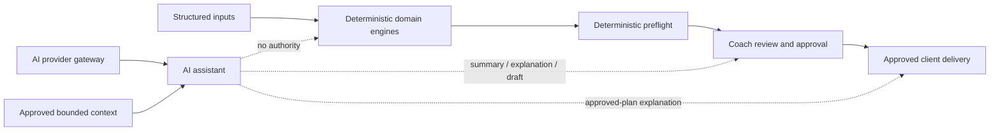

# Z Coaching Platform — AI Architecture

## 1. Foundational decision

AI is an assistant layer, not the brain of Z Coaching Platform.

The source of truth for safety, training, nutrition, cardio, mobility,
check-ins, adaptation, and plan validation is deterministic, versioned domain
code. No language model provider may replace or override that code.

## 2. Placement



AI should live behind an application-layer provider gateway. Domain packages
must remain provider-independent and must not import AI SDKs.

## 3. Permitted capabilities

### Coach-facing

- Summarize structured intake, flags, constraints, reasons, and issues.
- Compare two immutable plan versions using computed differences.
- Explain deterministic decisions and their approved evidence.
- Search approved internal documentation and knowledge.
- Draft clarification questions or client messages.
- Help locate clients or plans the authorized coach may access.

### Client-facing

- Explain an already-approved plan in clear language.
- Answer plan questions from approved plan and knowledge context.
- Help transform client feedback into a structured draft for confirmation.
- Encourage escalation to a coach or clinician when policy requires it.

### Administrative

- Summarize operational information the user is authorized to see.
- Draft documentation or release notes from verified system metadata.

## 4. Forbidden capabilities

AI must never:

- Determine that a client is medically safe.
- Diagnose or classify free-text medical information.
- Select or prescribe exercises, sets, reps, load, cardio dose, calories,
  macros, foods, grams, supplements, or adaptations outside domain output.
- Change a status, constraint, reason, issue, tolerance, or rule.
- Override a withheld or review-required decision.
- Approve or release a plan on behalf of a coach.
- Write directly to an authoritative plan record.
- invent scientific references or present unsupported claims as platform
  policy.
- Access another tenant or user outside explicit authorization.

## 5. Provider abstraction

The future AI gateway should expose provider-neutral operations such as:

```text
summarizeApprovedDecision(context)
explainApprovedPlan(context, question)
searchApprovedKnowledge(query, authorization)
draftCoachCommunication(context, intent)
structureClientFeedback(text, schema)
```

Provider details belong behind the gateway:

- Provider and model identifier.
- Prompt template version.
- Input/output size and cost controls.
- Timeout, retry, and fallback.
- Safety and redaction policy.
- Data residency and retention configuration.
- Audit metadata.

Switching ChatGPT, Gemini, or another provider must not change domain contracts
or scientific policy.

## 6. Context boundary

AI receives the minimum data needed for the authorized task:

- Approved or reviewable structured output.
- Explicitly selected reasons, constraints, and issues.
- Approved evidence excerpts and identifiers.
- User role and permitted action.

It should not receive:

- Complete catalog or client history when a small subset is sufficient.
- Secrets, credentials, payment data, or unrelated personal data.
- Internal hidden reasoning.
- Unapproved external content as if it were platform policy.

## 7. Structured suggestions

If AI helps structure client text or suggests an action:

1. Label the result as a suggestion.
2. Preserve the original text.
3. Require user confirmation when converting it to structured input.
4. Validate it against the domain contract.
5. Re-run the deterministic engine.
6. Show changed statuses/reasons to the coach.
7. Require the normal approval workflow.

AI output itself never becomes a domain decision.

## 8. Security and reliability controls

- Treat user text and retrieved documents as untrusted input.
- Defend against prompt injection and data-exfiltration instructions.
- Enforce authorization before retrieval and again before any action.
- Redact sensitive values from logs.
- Record provider, model, prompt version, context identifiers, and outcome.
- Provide deterministic fallback: AI failure must not block access to the
  authoritative plan.
- Display uncertainty and source links; never fabricate an answer.
- Monitor unsafe outputs, cross-tenant leakage, citation failures, and attempted
  policy override.

## 9. Human review and delivery

An AI-generated message may be delivered only under an explicit product policy:

- Coach drafts require coach review by default.
- Client explanations must be grounded in an approved plan.
- Safety-related reports route to the deterministic safety/check-in flow.
- A response cannot convert a withheld artifact into a deliverable plan.

## 10. Preconditions before implementation

Do not build the AI layer until these foundations exist:

- Stable domain outputs and versioned policies.
- Authentication and tenant-safe authorization.
- Versioned persistence and audit logging.
- Real coach approval workflow.
- Approved evidence registry.
- Data handling, retention, and incident policies.
- Evaluation suites for grounding, safety, privacy, and non-override behavior.

AI belongs in Phase 3 of [ROADMAP.md](ROADMAP.md).
