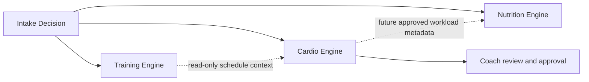
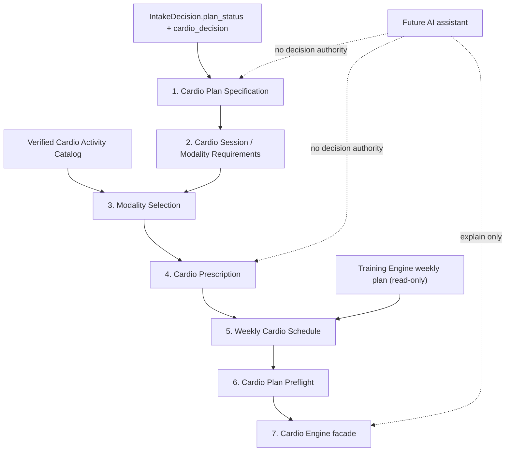

# Z Coaching Platform — Cardio Engine Domain Specification V1

| Field | Value |
|---|---|
| Document status | Documentation-first domain specification; no implementation exists |
| Specification identifier | `cardio-engine-domain-spec-v1` |
| Repository baseline reviewed | `676d3f94d137a670d400e6ab62a181a5ddd5875f` |
| Immediate approved implementation scope | Cardio Plan Specification V1 only |
| Authoritative upstream decision | `IntakeDecision.plan_status` and `IntakeDecision.cardio_decision` |
| Architecture | Pure, deterministic, domain-first |
| AI authority | None |

This document defines the target Cardio Engine architecture and the narrower
Cardio Plan Specification V1 that must be implemented first. It does not
authorize implementation of the complete pipeline in one task.

The words **MUST**, **MUST NOT**, **SHOULD**, and **MAY** are normative. No
numeric dose, intensity range, progression rule, clinical rule, or scheduling
interval in this document is approved unless it is linked to a reviewed
evidence record.

This specification must be read with:

- [PROJECT_MEMORY.md](PROJECT_MEMORY.md)
- [CURRENT_STATUS.md](CURRENT_STATUS.md)
- [ROADMAP.md](ROADMAP.md)
- [SYSTEM_ARCHITECTURE.md](SYSTEM_ARCHITECTURE.md)
- [DEVELOPMENT_RULES.md](DEVELOPMENT_RULES.md)
- [SCIENTIFIC_POLICY.md](SCIENTIFIC_POLICY.md)
- [AI_ARCHITECTURE.md](AI_ARCHITECTURE.md)

## 1. Purpose

### 1.1 Why Cardio Engine exists

The current Intake Decision Engine already decides whether the client should:

- Receive no additional cardio.
- Follow a daily-movement/steps-first path.
- Proceed toward formal cardio sessions.
- Wait for review.

It also returns session and duration capacity limits, an inherited starting
intensity classification, structured constraints, and reasons. It deliberately
does not build a cardio plan.

Cardio Engine exists to transform that authoritative upstream decision into a
versioned, testable cardio plan without repeating how the need was decided. Its
eventual responsibilities are:

1. Preserve upstream readiness, limits, constraints, and reasons.
2. Describe the required cardio session structure.
3. Select only an eligible structured modality.
4. Apply an evidence-backed frequency, duration, and intensity prescription.
5. Coordinate the resulting sessions with resistance training and reported
   additional sports.
6. Validate the complete result in a Cardio Preflight stage.
7. Expose the stages through a thin Cardio Engine facade.

### 1.2 Role inside Z Coaching Platform

Cardio Engine is one deterministic domain pipeline beside Training Engine and
Nutrition Engine:



The arrows do not authorize circular business logic:

- Cardio Engine MUST NOT change the Intake Decision.
- Cardio Engine MUST NOT change the resistance-training draft or schedule.
- Cardio Engine MUST NOT change calories, macros, meals, foods, or portions.
- Nutrition Engine MAY consume approved cardio workload in a future versioned
  policy, but Cardio Engine does not calculate the nutritional consequence.
- Training Engine remains the owner of resistance sessions.
- A future cross-domain application orchestrator may call both engines and
  persist their immutable outputs.

### 1.3 Decisions that belong to Cardio Engine

After Intake has authorized a path, the complete future Cardio Engine owns:

- Representing whether the upstream strategy requires no formal plan, a
  daily-movement-only plan, a formal-session plan, or review.
- Modality eligibility based only on explicit structured constraints and
  verified modality metadata.
- Session format and cardio-type classification.
- Actual frequency below or equal to the upstream capacity limit.
- Actual duration below or equal to the upstream capacity limit.
- Operational intensity method and target.
- Evidence-backed progression and regression instructions.
- Read-only coordination with the resistance schedule and additional sports.
- Cardio-specific preflight consistency and review eligibility.
- Structured Cardio-owned reasons, issues, and applied rule identifiers.

### 1.4 Decisions that do not belong to Cardio Engine

Cardio Engine does not own:

- Medical screening, diagnosis, medical clearance, pregnancy routing, pain
  routing, or dangerous-symptom interpretation.
- The choice between `READY_FOR_DRAFT`, `COACH_REVIEW_REQUIRED`,
  `MEDICAL_REVIEW_REQUIRED`, and `BLOCKED`.
- Re-evaluating whether steps, lifestyle activity, additional sports, or goals
  create a need for cardio.
- Deriving a hidden goal from free text.
- Resistance-training frequency, split, exercise selection, sets, repetitions,
  or training progression.
- Calories, macros, food selection, portion solving, or nutrition adaptation.
- Interpreting medication, condition, injury-area, or preference text.
- Check-in validation or longitudinal adaptation.
- Human coach approval, medical approval, delivery, persistence, API, UI, or
  notifications.
- AI-generated type, dose, schedule, progression, regression, or safety
  decisions.

## 2. Architecture Rules

### 2.1 Target stage sequence

The complete target pipeline is:



These stages MUST be implemented as separately scoped roadmap items. The
current approved implementation item is stage 1 only.

### 2.2 Stage ownership

| Stage | Owns | Must not do |
|---|---|---|
| Plan Specification | Normalize upstream status, strategy, limits, constraints, and reasons | Select type, modality, dose, or weekday |
| Session/Modality Requirements | Describe what kind of session is required | Select a concrete activity or invent dose |
| Modality Selection | Match requirements, preferences, and explicit restrictions against a verified catalog | Diagnose or infer a restriction |
| Prescription | Apply approved frequency, duration, intensity, interval, progression, and regression policies | Recompute need or exceed caps |
| Weekly Schedule | Place prescribed sessions around immutable training/sport context | Move or rewrite resistance sessions |
| Preflight | Verify versions, status, dose, schedule, constraints, and evidence-rule links | Rebuild the plan or record human approval |
| Engine Facade | Call public stage APIs in order and expose full stage outputs | Copy business rules or alter stage results |

### 2.3 Non-negotiable rules

1. Cardio Engine MUST consume existing client decisions.
2. It MUST NOT duplicate or rerun Intake Engine cardio-need logic.
3. It MUST NOT duplicate or reinterpret Safety logic.
4. It MUST NOT infer meaning from free text.
5. It MUST NOT use AI for any domain decision.
6. Every executable decision MUST be deterministic and testable.
7. The same versioned inputs MUST produce deeply equal outputs.
8. No device clock, randomness, hidden network lookup, or mutable global state
   may affect a result.
9. Inputs MUST remain unchanged, mutable, and unfrozen.
10. Outputs MUST be independent and deeply frozen.
11. A downstream stage may retain or lower readiness for a stage-owned issue;
    it MUST NOT promote a provisional or withheld upstream artifact.
12. A withheld result MUST contain no executable sessions.
13. Constraints and reasons MUST be copied by value and preserved.
14. Upstream errors and `TypeError`s MUST not be swallowed.
15. Every stage MUST validate source versions when the public upstream contract
    exposes them, and MUST always validate structural and cross-stage identity.

### 2.4 Status model

Construction stages use:

```text
READY
PROVISIONAL_REVIEW_REQUIRED
WITHHELD
```

Cardio Preflight and the future facade use:

```text
READY
REVIEW_REQUIRED
WITHHELD
```

The initial mapping is:

| Intake `plan_status` | Construction status |
|---|---|
| `READY_FOR_DRAFT` | `READY` |
| `COACH_REVIEW_REQUIRED` | `PROVISIONAL_REVIEW_REQUIRED` |
| `MEDICAL_REVIEW_REQUIRED` | `WITHHELD` |
| `BLOCKED` | `WITHHELD` |

`COACH_REVIEW_REQUIRED` may be caused by another domain. Cardio stages
therefore preserve a provisional result where structurally possible, but
`cardio_decision.strategy=REVIEW_REQUIRED` still prohibits executable cardio
sessions until review.

Preflight status is authoritative for the final Cardio Engine status. A facade
MUST NOT independently upgrade or downgrade it.

## 3. Inputs

### 3.1 Immediate Cardio Plan Specification V1 input

The first implementation MUST accept the full existing `IntakeDecision` as its
single argument:

```text
buildCardioPlanSpec(intakeDecision)
```

It reads only the following authoritative fields:

```text
CardioPlanSpecificationInput
  plan_status
  cardio_decision
    strategy
    max_sessions
    max_duration_minutes
    intensity_start
    constraints
    reasons
```

Current upstream enums are:

```text
strategy:
  NO_ADDITIONAL_CARDIO
  STEPS_ONLY
  CARDIO_SESSIONS
  REVIEW_REQUIRED

intensity_start:
  LOW
  MODERATE
```

This is not a new closed wrapper containing only two fields. The builder MUST
accept the other documented top-level `IntakeDecision` fields produced by
`evaluateIntake`. It MUST NOT read them to repeat the cardio decision. Unknown
fields inside `cardio_decision` indicate a mismatched contract and must be
rejected; validation of unrelated top-level Intake fields remains owned by
Intake Engine.

Required structural invariants:

- `plan_status` is a known Intake status.
- `strategy` is a known current `CardioStrategy`.
- `max_sessions` and `max_duration_minutes` are non-negative integers.
- `CARDIO_SESSIONS` requires both limits to be positive.
- Every other current strategy requires both limits to be zero.
- `intensity_start` is `LOW` or `MODERATE`.
- `NO_ADDITIONAL_CARDIO`, `STEPS_ONLY`, and `REVIEW_REQUIRED` require
  `intensity_start=LOW`; only `CARDIO_SESSIONS` may contain `LOW` or `MODERATE`.
- `READY_FOR_DRAFT` cannot pair with `REVIEW_REQUIRED`.
- `MEDICAL_REVIEW_REQUIRED` and `BLOCKED` require `REVIEW_REQUIRED`, zero limits,
  and `LOW` intensity under the current Intake contract.
- Each constraint has `{code, scope, value, reason}` and a `CARDIO` or `GLOBAL`
  scope.
- Each reason has `{code, scope, message}` and `scope=CARDIO`.
- `constraints` and `reasons` are arrays of valid structured records.
- Every reason has a stable code, `CARDIO` scope, and non-empty message.
- Source array order is preserved exactly.
- Constraint codes may repeat for distinct records such as multiple
  `EXISTING_ADDITIONAL_SPORT` constraints. Constraints MUST NOT be deduplicated
  by code.

The current Intake Decision has no runtime decision-version field. Plan
Specification MUST NOT invent one. Its own version identifies the downstream
contract. A future Intake contract may add runtime provenance through a
separate backward-compatible versioning task.

### 3.2 Client-factor provenance

The requested client factors are important, but most are already interpreted
by Intake. They are provenance, not permission to repeat Intake rules:

| Factor | Authoritative source/owner | Cardio Engine use |
|---|---|---|
| Goal | Intake goal and resulting `cardio_decision.strategy/reasons` | Follow the decision; do not re-decide need |
| Experience level | Intake uses current training experience when selecting inherited `intensity_start` | Do not treat resistance experience as proven cardio skill |
| Current activity level | Intake lifestyle/cardio rules | Follow strategy and reasons |
| Daily steps | Intake cardio rules | Do not reapply step thresholds |
| Lifestyle activity | Intake cardio rules | Do not recalculate sufficiency |
| Available time | `max_sessions` and `max_duration_minutes` | Treat as ceilings only |
| Preferences | No current structured cardio-preference contract exists | No V1 inference; future typed profile required |

Important gaps:

- Training experience is not a cardio-specific experience assessment.
- `intensity_start` is only `LOW` or `MODERATE`; it is not an RPE, heart-rate
  zone, pace, power target, or representation of high intensity.
- No current field expresses preferred modality, disliked modality, available
  cardio equipment, preferred cardio days, or impact preference.
- Free text MUST NOT fill these gaps.

A future structured `CardioPreferenceProfile` may be introduced through a
separate upstream contract task. It must use known codes, permit an empty
preference array, retain unclassified text for review, and never override
safety or eligibility.

### 3.3 Training-factor provenance

The complete future Cardio Engine requires a read-only public Training Engine
output for scheduling:

| Factor | Authoritative representation | Cardio use |
|---|---|---|
| Resistance frequency | `weekly_training_plan.recommended_days` and sessions | Total-load and scheduling context only |
| Training volume | `volume_start` plus prescribed session contents | Recovery/interference context under an approved policy |
| Training split | `split_code`, session focus, and session codes | Identify possible scheduling conflicts |
| Training days | `scheduled_day` or session-sequence mode | Placement context |
| Recovery capacity | No canonical score exists | Use only explicit upstream conservative/review signals; do not invent a score |
| Additional sports | Structured `EXISTING_ADDITIONAL_SPORT` constraints | Preserve and coordinate without reclassifying need |

The scheduler MUST consume the public Training Engine contract. It MUST NOT
import private training helpers or recalculate the training split.

If Training is in `SESSION_SEQUENCE` mode, Cardio Scheduling cannot fabricate
calendar weekdays. It must retain sequence-based coordination or require coach
review under a future approved scheduling policy.

### 3.4 Health-factor provenance

Health factors reach Cardio Engine only as authoritative status and structured
constraints:

| Health factor | Authoritative representation | Permitted downstream behavior |
|---|---|---|
| Injuries | Intake status and `INJURY_AFFECTED_MOVEMENT` / medical restriction constraints | Exclude a directly conflicting catalog modality only |
| Medical restrictions | Structured `MEDICAL_MOVEMENT_RESTRICTION` and `INJURY_MEDICAL_RESTRICTION` | Apply exact `AVOID` mapping; do not diagnose |
| Safety limitations | `plan_status`, `cardio_decision.strategy`, constraints, reasons | Withhold or retain review exactly |
| Unclassified information | Review flags/reasons owned upstream | Preserve; never map to a modality restriction |

There must be no downstream diagnosis table such as “condition X means no
HIIT.” Any new clinical gate belongs to a separately reviewed Safety policy.

A modality selector may apply an exact structured restriction—for example, an
explicit `RUNNING` avoidance constraint excludes a `RUNNING` modality whose
catalog metadata declares that movement. It may not infer that an injury area
means running is unsafe.

### 3.5 Goal-factor behavior

Goal families must be handled as follows:

| Goal | Current authority | Cardio Engine rule |
|---|---|---|
| Fat loss | Intake already states that fat loss alone does not require formal cardio | Do not create sessions merely to increase expenditure |
| Muscle gain | Intake determines current cardio need | Protect the resistance plan; no automatic cardio removal or addition |
| General health | Intake determines current strategy | Do not invent public-health dose until evidence policy is approved |
| Performance | Intake may authorize formal sessions through the current structured decision | Prescription must still use evidence-backed type and dose |
| Conditioning | No canonical primary-goal code currently exists | Requires a future structured goal contract; no free-text inference |

The downstream engine consumes the resulting strategy. It does not perform a
second goal decision.

### 3.6 Future full-engine input boundary

The target facade will eventually accept a bundle conceptually equivalent to:

```text
CardioEngineInput
  intake_decision
  training_engine_output
  cardio_activity_catalog
  cardio_preference_profile (only after a versioned upstream contract exists)
```

Rules:

- `intake_decision` owns need, safety status, limits, inherited intensity,
  constraints, and reasons.
- `training_engine_output` is read-only scheduling context.
- `cardio_activity_catalog` supplies verified modality and mechanical-demand
  metadata; it is not an external runtime search.
- A preference profile affects tie-breaking only among already eligible
  choices.
- Missing future contracts must result in a deliberate review/unsupported
  state, not guessed values.

## 4. Cardio Decision Logic

### 4.1 Ownership of “when cardio is needed”

Cardio Engine MUST follow the existing strategy:

| Upstream strategy | Downstream meaning |
|---|---|
| `NO_ADDITIONAL_CARDIO` | A valid plan with no formal cardio sessions |
| `STEPS_ONLY` | A valid daily-movement path with no formal cardio sessions |
| `CARDIO_SESSIONS` | Formal prescription may proceed within limits after evidence-backed stages exist |
| `REVIEW_REQUIRED` | No executable cardio or step prescription before review |

The downstream engine must not reproduce the existing Intake ordering involving
safety, movement restrictions, sport load, daily steps, lifestyle activity,
goals, and capacity.

`STEPS_ONLY` currently contains no numeric step target. Cardio Plan
Specification V1 MUST preserve the strategy without inventing a target,
increment, schedule, or progression.

### 4.2 When cardio is avoided or withheld

The deterministic precedence is:

1. `MEDICAL_REVIEW_REQUIRED` or `BLOCKED` → `WITHHELD`; no sessions.
2. `cardio_decision.strategy=REVIEW_REQUIRED` → no executable sessions.
3. Explicit structured modality restriction → exclude that modality only.
4. No eligible modality → stage-owned review issue; do not force a choice.
5. No evidence-approved prescription policy → no executable dose; do not use
   the client cap as the dose.

The engine does not inspect raw symptoms, pain, pregnancy, medical conditions,
medications, or free text to create a new contraindication.

### 4.3 Initial volume

The initial prescribed frequency and duration MUST:

- Be selected by a versioned evidence-backed Cardio Prescription policy.
- Be positive only for `CARDIO_SESSIONS`.
- Not exceed `max_sessions`.
- Not exceed `max_duration_minutes` per session.
- Account for approved existing-sport and resistance-load rules without
  recalculating the upstream need decision.
- Produce structured applied-rule and reason codes.
- Remain absent in Plan Specification V1.

Capacity is not prescription. Selecting `max_sessions` or
`max_duration_minutes` merely because it is available is prohibited.

### 4.4 When volume may increase

Initial Cardio Engine V1 MUST NOT adapt an existing plan. A future Adaptation
Engine may propose an increase only when all of the following have structured,
validated outcomes:

- The current plan is approved and its version is known.
- The observation window and data quality meet an approved policy.
- Adherence is sufficient to interpret the outcome.
- Safety status remains clear.
- Recovery and fatigue findings permit progression.
- Resistance performance is not declining under the approved definition.
- The goal/outcome finding indicates that progression is appropriate.
- The new dose remains within client capacity and policy ceilings.
- Progression magnitude and cadence are evidence-backed.

Whether one or multiple dose dimensions may change at once remains
evidence-gated. No default, numeric increment, cadence, or observation window
is approved here.

### 4.5 When volume may decrease

A future Adaptation Engine may hold, regress, require review, or withhold a plan
when structured findings indicate:

- A new Safety or medical-review state.
- Poor recovery under an approved definition.
- Excess fatigue under an approved definition.
- Resistance or target performance decline under an approved definition.
- Repeated inability to complete the prescribed dose.
- A capacity or scheduling conflict.

A candidate conservative policy is to avoid increasing dose solely because of
low adherence. That response is not approved here; the final action, rule, and
threshold require evidence and product-policy approval.

### 4.6 Deterministic tie-breaking

Any future eligible-choice tie MUST use an explicit order, such as:

1. Exact safety and movement eligibility.
2. Ability to satisfy the inherited starting intensity.
3. Client’s structured positive preference.
4. Client’s available equipment/environment.
5. Lower approved recovery/interference cost.
6. Stable catalog priority.
7. Canonical modality code.

This order is a design placeholder. Its scientific elements and final sequence
must be reviewed before implementation. Catalog iteration order alone must not
silently decide a result.

## 5. Cardio Types

### 5.1 Orthogonal model

`LISS`, `MISS`, `HIIT`, `INTERVALS`, and `CONDITIONING` are not five clean,
mutually exclusive physiological primitives:

- LISS and MISS require an operational intensity definition.
- HIIT is a high-intensity subset of interval training.
- Intervals may be low, moderate, or high intensity.
- Conditioning describes an intent or family and may overlap cardio,
  resistance circuits, and sport.
- Metabolic intensity and mechanical impact are different. Steady running may
  be mechanically demanding; high-intensity cycling may be lower impact.

The executable contract should therefore model independent axes:

```text
session_format
  CONTINUOUS
  INTERVAL

intensity_band
  LOW
  MODERATE
  HIGH (future only; not authorized by current Intake output)

intensity_method
  versioned method code + target + unit

modality_code
  verified catalog activity

training_intent
  approved structured intent

protocol_code
  null for continuous work; required for interval work

mechanical_demand
  verified catalog metadata, separate from metabolic intensity
```

`cardio_type` may be a stable reader-facing derived classification, but it
MUST NOT be the sole driver of safety, intensity, or recovery decisions.

### 5.2 LISS

Definition target: continuous work in an approved low-intensity band.

Suitable cases:

- Upstream strategy is `CARDIO_SESSIONS`.
- Inherited `intensity_start` permits low intensity.
- A modality is eligible under explicit constraints.
- An approved LISS intensity definition and prescription rule exists.

Blocking conditions and inherited restrictions:

- Any upstream withheld or unresolved cardio-review state.
- An exact movement restriction that conflicts with the selected modality.
- Inability to operationalize the chosen intensity method.

Training and recovery interaction:

- It may become a lower-recovery-cost candidate, but that ranking requires
  evidence for the selected modality and dose.
- “Low intensity” does not automatically mean “low impact.”
- Scheduling still considers duration, modality, resistance focus, and sport
  load.

Evidence gate:

`CARDIO_TYPE_LISS_REFERENCE_REQUIRED — DO NOT IMPLEMENT PRESCRIPTION`

### 5.3 MISS

Definition target: continuous work in an approved moderate-intensity band.

Suitable cases:

- Upstream strategy is `CARDIO_SESSIONS`.
- Current inherited `intensity_start` is `MODERATE`.
- The selected modality and measurement method support a valid moderate target.
- Recovery and concurrent-training rules permit the planned dose.

Blocking conditions and inherited restrictions:

- `intensity_start=LOW` must not be upgraded downstream.
- Any upstream review/withheld state.
- An exact structured restriction conflicting with the modality.

Training and recovery interaction:

- The plan must account for total dose and placement relative to resistance
  sessions.
- The specification must not assume MISS has the same cost across modalities.

Evidence gate:

`CARDIO_TYPE_MISS_REFERENCE_REQUIRED — DO NOT IMPLEMENT PRESCRIPTION`

### 5.4 HIIT

Definition target: an interval protocol containing an approved high-intensity
work phase and structured recovery phase.

Suitable cases:

- None are automatically eligible under the current V1 Intake contract.
- The current `CardioIntensity` output stops at `MODERATE`.
- A future high-intensity contract, protocol, evidence record, and applicable
  status/restriction policy are prerequisites.

Blocking conditions and inherited restrictions:

- Current V1 automatic selection is prohibited.
- No disease-name, medication, age, injury-area, or free-text inference may be
  added inside Cardio Engine.
- A future policy must consume authoritative Safety statuses and exact modality
  restrictions. If a later human medical-clearance workflow requires explicit
  clearance, only its recorded structured result may be used; Cardio Engine
  cannot manufacture clearance.

Training and recovery interaction:

- Interference, sequencing, work/recovery structure, and total high-intensity
  load require explicit evidence.
- Existing high-intensity sports must not be silently ignored or double
  counted.

Evidence gate:

`CARDIO_TYPE_HIIT_REFERENCE_REQUIRED — NOT AUTHORIZED FOR V1`

### 5.5 Intervals

Definition target: alternating work and recovery periods at explicitly
specified intensities. “Intervals” alone does not imply HIIT.

Suitable cases:

- A verified `protocol_code` defines work duration, recovery duration, repeat
  count, both intensity targets, modality compatibility, and total duration.
- The first-plan intensity conforms to the inherited `intensity_start`; no
  downstream stage upgrades it.

Blocking conditions and inherited restrictions:

- No protocol may be assembled from free-form text.
- Missing work/recovery dose or intensity method makes the session invalid.
- A generic `INTERVALS` label cannot substitute for an executable protocol.

Training and recovery interaction:

- The complete protocol load, not the label, is used for scheduling and
  preflight.

Evidence gate:

`CARDIO_INTERVAL_PROTOCOL_REFERENCE_REQUIRED — DO NOT IMPLEMENT`

### 5.6 Conditioning work

Definition target: a structured training intent that improves a declared
performance/conditioning quality. It is not one universal cardio modality.

Suitable cases:

- A future structured conditioning goal exists.
- A verified catalog and protocol identify the modality, movement demands,
  session format, intensity, and dose.
- The work is not already owned by the resistance plan or reported sport.

Blocking conditions and inherited restrictions:

- Current Intake has no canonical `CONDITIONING` primary-goal code.
- Free-text `secondaryTraining` or sport text cannot be interpreted.
- Circuits, carries, resistance complexes, and sport practice must not be
  silently relabeled as cardio to bypass Training or sport-load logic.

Training and recovery interaction:

- Overlap with resistance volume and additional sports must be explicit.
- The owner of each workload must remain identifiable to prevent double
  counting.

Evidence gate:

`CARDIO_CONDITIONING_REFERENCE_REQUIRED — DO NOT IMPLEMENT`

## 6. Prescription Output

### 6.1 Cardio Plan Specification V1 contract

The immediate implementation MUST use:

```text
src/cardio-plan-specification/
  domain/contracts.js
  domain/enums.js
  build-cardio-plan-spec.js
  index.js

test/cardio-plan-specification.test.js
```

Package subpath:

```text
./cardio-plan-specification
```

The public API MUST expose exactly:

```text
CARDIO_PLAN_SPEC_VERSION
CardioPlanStatus
CardioFormalSessionState
buildCardioPlanSpec
```

`CardioStrategy` and `CardioIntensity` remain owned by Intake Decision Engine.
Plan Specification validates their values through the upstream public contract
and MUST NOT redefine or re-export them.

Version:

```text
cardio-plan-spec-v1
```

Builder:

```text
buildCardioPlanSpec(intakeDecision)
```

The builder MUST return:

```json
{
  "cardio_plan_spec_version": "cardio-plan-spec-v1",
  "status": "READY",
  "strategy": "CARDIO_SESSIONS",
  "formal_session_state": "PRESCRIPTION_REQUIRED",
  "limits": {
    "max_sessions_per_week": 2,
    "max_duration_minutes_per_session": 30,
    "intensity_start": "LOW"
  },
  "constraints": [],
  "reasons": []
}
```

The `2` and `30` values illustrate client-supplied upstream capacity limits
already supported by the current contract. They are not recommended frequency
or duration values.

`CardioFormalSessionState` MUST contain exactly:

```text
NOT_INDICATED
DAILY_MOVEMENT_ONLY
PRESCRIPTION_REQUIRED
REVIEW_REQUIRED
WITHHELD
```

`CardioPlanStatus` MUST contain exactly:

```text
READY
PROVISIONAL_REVIEW_REQUIRED
WITHHELD
```

Deterministic mapping:

| Construction status / strategy | `formal_session_state` |
|---|---|
| `WITHHELD` | `WITHHELD` |
| Any non-withheld `REVIEW_REQUIRED` | `REVIEW_REQUIRED` |
| `NO_ADDITIONAL_CARDIO` | `NOT_INDICATED` |
| `STEPS_ONLY` | `DAILY_MOVEMENT_ONLY` |
| `CARDIO_SESSIONS` | `PRESCRIPTION_REQUIRED` |

Negative-space requirements:

- No `sessions` field.
- No actual frequency.
- No actual duration.
- No modality or cardio type.
- No heart-rate, RPE, talk-test, pace, or power target.
- No weekday.
- No progression or regression dose.
- No step target.

The limits are preserved ceilings. This stage does not use them as
recommendations.

Plan Specification MUST deep-clone `constraints` and `reasons` in their exact
upstream order. It does not sort, deduplicate, rewrite, or append stage-owned
records.

### 6.2 Future complete Cardio Engine output

The target facade output is conceptually:

```json
{
  "cardio_engine_version": "cardio-engine-v1",
  "status": "REVIEW_REQUIRED",
  "engine_policy": "Z_COACHING_CARDIO_ENGINE_V1",
  "ready_for_coach_review": true,
  "source_versions": {
    "cardio_plan_specification": "cardio-plan-spec-v1",
    "cardio_session_blueprint": "cardio-session-blueprint-v1",
    "cardio_modality_selection": "cardio-modality-selection-v1",
    "cardio_prescription": "cardio-prescription-v1",
    "weekly_cardio_schedule": "weekly-cardio-schedule-v1",
    "cardio_plan_preflight": "cardio-plan-preflight-v1",
    "training_engine": "training-engine-v1",
    "cardio_activity_catalog": "catalog-version-from-input"
  },
  "stages": {
    "plan_specification": {},
    "session_blueprint": {},
    "modality_selection": {},
    "prescription": {},
    "weekly_schedule": {
      "weekly_cardio_schedule_version": "weekly-cardio-schedule-v1",
      "status": "PROVISIONAL_REVIEW_REQUIRED",
      "strategy": "CARDIO_SESSIONS",
      "frequency_per_week": null,
      "sessions": [],
      "constraints": [],
      "applied_restrictions": [],
      "reasons": [],
      "applied_rule_codes": []
    },
    "plan_preflight": {}
  }
}
```

The values above illustrate a non-executable, review-required shape. `null`
shows that no evidence-backed frequency has been approved; it MUST NOT be
replaced with a client capacity limit.

Rules:

- Final status is copied from Cardio Preflight only.
- `ready_for_coach_review` is copied from Preflight and is not proof of
  approval.
- Full stage outputs are retained unchanged for auditability.
- `stages.weekly_schedule` owns the final planned sessions and is the
  authoritative plan representation.
- The facade MUST NOT build a second consolidated plan object or reshape the
  weekly schedule.
- The complete activity catalog is not embedded in the output.
- A withheld weekly schedule has `frequency_per_week=null` and `sessions=[]`.
- A `NO_ADDITIONAL_CARDIO` or `STEPS_ONLY` weekly schedule has no formal
  sessions.
- A ready `frequency_per_week` equals the count of executable formal sessions.
- Constraints and reasons preserve all upstream records and order.
- Modality Selection owns `applied_restrictions`. Each record must reference
  the exact source constraint record and its deterministic eligibility effect;
  it is not a renamed or reinterpreted medical constraint.
- Stage-owned reasons may use first-occurrence deduplication by their stable
  reason code under an explicit policy.
- Constraints are never deduplicated by code because multiple records may
  legitimately share a code and carry different values or source paths.

Cardio Preflight MUST define:

| Preflight status | `ready_for_coach_review` |
|---|---:|
| `READY` | `true` |
| `REVIEW_REQUIRED` | `true` |
| `WITHHELD` | `false` |

This boolean means eligible to enter or continue the coach-review workflow. It
does not mean that a coach can approve every issue, and it never records an
actual approval.

### 6.3 Future session contract

Each formal prescribed session should contain:

```json
{
  "sequence": 1,
  "session_code": "CARDIO_1",
  "cardio_type": null,
  "session_format": "CONTINUOUS",
  "modality_code": "VERIFIED_CATALOG_CODE",
  "training_intent": "VERSIONED_INTENT_CODE",
  "duration_minutes": null,
  "intensity": {
    "band": "LOW",
    "method": "VERSIONED_METHOD_CODE",
    "target_min": null,
    "target_max": null,
    "unit": "VERSIONED_UNIT_CODE"
  },
  "protocol_code": null,
  "progression": {
    "strategy_code": "REFERENCE_REQUIRED",
    "eligibility_rule_codes": [],
    "parameters": null
  },
  "regression": {
    "strategy_code": "REFERENCE_REQUIRED",
    "trigger_rule_codes": [],
    "parameters": null
  },
  "schedule": {
    "scheduled_day": null,
    "schedule_mode": "FIXED_DAYS",
    "relation_to_training": "VERSIONED_RELATION_CODE"
  },
  "applied_restrictions": [],
  "reasons": [],
  "applied_rule_codes": []
}
```

`null` and `REFERENCE_REQUIRED` in this illustration identify unapproved
scientific fields. A ready executable future session must contain complete
values validated against approved policies.

`cardio_type` is a derived reader-facing field, not a mutually exclusive enum
containing all five conceptual families:

- LISS is derived only from `CONTINUOUS` plus an approved low-intensity band.
- MISS is derived only from `CONTINUOUS` plus an approved moderate-intensity
  band.
- HIIT is derived only from `INTERVAL` plus an approved high-intensity protocol.
- Intervals are represented by `session_format=INTERVAL`.
- Conditioning is represented by `training_intent`, not as a peer session
  format.

Any derived `cardio_type` mapping requires a versioned policy, applied rule
code, evidence link, and tests.

### 6.4 Intensity method

The output MUST name the method used to operationalize intensity. Candidate
method families may include:

- Talk-test descriptor.
- Session RPE scale.
- Heart-rate reserve percentage.
- Percentage of measured or estimated maximum heart rate.
- Pace.
- Power.

No method, equation, range, or target is approved in this document. Each
requires:

- Population applicability.
- Measurement prerequisites.
- Units and range.
- Fallback behavior.
- Medication/device limitations without free-text inference.
- Evidence record.
- Boundary tests.

If a method cannot be applied reliably, the engine requires review; it does not
silently substitute another method.

## 7. Interaction With Training Engine

### 7.1 Ownership

Training Engine builds and validates resistance training first. Cardio
Scheduling receives its public weekly plan as caller-owned, read-only context.
Current Training outputs are not guaranteed to be deeply frozen; Cardio MUST
neither mutate nor freeze them and must clone every retained value.

Cardio Engine MUST NOT:

- Change `recommended_days`.
- Change the training split.
- Move resistance sessions.
- Change exercises, sets, targets, or rest.
- Convert a Training review finding into a ready state.

### 7.2 Conflict precedence

Future weekly coordination follows this ownership order:

1. Upstream Safety status and explicit restrictions.
2. Client capacity and structured availability.
3. Existing resistance schedule.
4. Existing additional-sport schedule and load.
5. Eligible cardio prescription.
6. Structured client preference.
7. Evidence-backed deterministic placement tie-breaker.

If no eligible placement exists, Cardio Scheduling must return a structured
review issue. It must not force a collision or rewrite Training.

### 7.3 Recovery protection

Recovery protection must consider, through versioned public data:

- Resistance frequency.
- Session focus and lower-body demand.
- Prescribed resistance volume.
- Intro/conservative start signals.
- Existing sport days and intensity.
- Cardio modality, mechanical demand, format, intensity, and duration.
- Client capacity and future validated recovery findings.

The exact rules for:

- Same-day versus separate-day placement.
- Cardio before versus after resistance training.
- Minimum spacing.
- High-intensity placement.
- Lower-body conflict.
- Weekly high-intensity-load ceilings.

are not approved here. Each requires scientific evidence and explicit tests.

### 7.4 Schedule modes

For fixed training days:

- Cardio Scheduling may assign a fixed day only under an approved placement
  policy.
- It must preserve all resistance and sport-day context in the output.

For session-sequence training:

- It must not fabricate weekdays.
- It may return sequence relationships under an approved policy.
- If safe coordination cannot be represented, status becomes review-required.

### 7.5 Status interaction

- Intake medical/blocking status always withholds Cardio.
- A Training Preflight `WITHHELD` caused by a global upstream state will already
  correspond to withheld Cardio.
- A Training review caused only by exercise selection or scheduling does not
  automatically prove Cardio unsafe; Cardio remains at least provisional until
  the conflict is resolved.
- Cardio Scheduling may lower Cardio readiness for its own unresolved
  coordination issue.
- Neither engine may promote the other.

### 7.6 Nutrition interaction

Cardio Engine does not change a nutrition plan. In a future adaptation version:

- Nutrition may consume approved completed cardio workload.
- Energy-target adjustment remains a Nutrition/Adaptation policy.
- A planned session is not assumed to have been completed.
- Any workload-to-energy conversion requires its own evidence record.

## 8. Adaptation Preparation

Adaptation is not part of the initial Cardio Engine. The output must nevertheless
remain traceable enough for future Check-in and Adaptation Engines.

Sections 8.3 through 8.7 list candidate design responses only. They are
non-executable and non-normative until an approved Check-in contract,
Adaptation policy, evidence record, and tests define the exact behavior.

### 8.1 Required future adaptation inputs

```text
CardioAdaptationInput
  approved_plan_version
  applicable_cardio_policy_version
  completed_session_records
  validated_check_in_decision
    safety_status
    data_quality
    observation_window
    adherence_finding
    recovery_finding
    performance_finding
    fatigue_finding
  progress_tracking_summary
  current_client_capacity
```

Raw check-in prose is not an adaptation input. It must first pass through a
structured Check-in contract and Safety routing.

### 8.2 Future adaptation outcomes

```text
HOLD
PROGRESS
REGRESS
REVIEW_REQUIRED
WITHHOLD
```

Every outcome must include:

- Prior plan version.
- Trigger finding codes.
- Applied adaptation rule codes.
- Bounded changes.
- Unchanged fields.
- Reasons.
- Evidence-policy version.
- Review eligibility.

The prior approved plan is never overwritten.

### 8.3 Weight plateau

Possible future logic:

- Candidate validation would examine measurement quality, an approved plateau
  definition, and an approved observation window.
- Nutrition and training adherence would come from their authoritative
  findings.
- A plateau would not itself establish that cardio is insufficient.
- Candidate outcomes include hold, review, or a bounded proposal; automatic
  addition or increase is not approved.

Required evidence placeholder:

`CARDIO_ADAPT_PLATEAU_REFERENCE_REQUIRED — DO NOT IMPLEMENT`

### 8.4 Poor recovery

Possible future logic:

- Candidate outcomes include hold, regress, review, or withhold rather than
  automatic progression.
- The resistance plan would remain unchanged while a cross-domain Adaptation
  coordinator resolves ownership.
- New safety symptoms would return to Safety rather than a cardio dose rule.

Required evidence placeholder:

`CARDIO_ADAPT_POOR_RECOVERY_REFERENCE_REQUIRED — DO NOT IMPLEMENT`

### 8.5 Low adherence

Possible future logic:

- A candidate conservative response avoids increasing dose merely because of
  non-completion.
- Plan feasibility and adherence context would use structured data only.
- Candidate outcomes include hold, simplify, regress, or coach review.
- The original prescription would be preserved and any proposal recorded
  separately.

Required evidence placeholder:

`CARDIO_ADAPT_LOW_ADHERENCE_REFERENCE_REQUIRED — DO NOT IMPLEMENT`

### 8.6 Performance decline

Possible future logic:

- Candidate validation would cover the performance metric, comparison window,
  and data quality.
- Concurrent resistance/sport load would come from authoritative outputs.
- Candidate outcomes include hold, regress, or review rather than automatic
  progression.

Required evidence placeholder:

`CARDIO_ADAPT_PERFORMANCE_DECLINE_REFERENCE_REQUIRED — DO NOT IMPLEMENT`

### 8.7 Excess fatigue

Possible future logic:

- A validated fatigue finding, not raw-text interpretation, would drive the
  decision.
- Candidate outcomes include hold, regress, review, or withhold rather than
  automatic progression.
- New medical/safety findings would return to Safety.

Required evidence placeholder:

`CARDIO_ADAPT_EXCESS_FATIGUE_REFERENCE_REQUIRED — DO NOT IMPLEMENT`

## 9. Scientific Foundation

### 9.1 Evidence hierarchy

Each new scientific rule must follow the repository hierarchy:

```text
Authoritative guidelines
  -> professional position stands / consensus statements
  -> systematic reviews and meta-analyses
  -> controlled trials
  -> observational evidence where necessary
  -> explicitly labeled expert practice or conservative product policy
```

Applicability, population, exclusions, outcome, recency, methodology, and
limitations matter in addition to source type.

### 9.2 Existing policy versus new evidence

The current Intake cardio thresholds and routing are inherited upstream facts.
They are not re-approved by this specification. The repository already records
cardio thresholds as scientific-traceability debt.

No additional scientific evidence is required for pure architecture rules such
as:

- Mapping Intake status to downstream status.
- Preserving a capacity limit without exceeding it.
- Copying constraints and reasons.
- Returning no sessions for a withheld state.
- Determinism, validation, immutability, and version checking.

Scientific evidence is required before implementing:

- Actual initial frequency.
- Actual duration or weekly dose.
- Intensity definitions and measurement methods.
- Modality/type selection.
- Any interval or HIIT protocol.
- Progression and regression.
- Sport-load equivalence.
- Concurrent-training order, spacing, and total-load rules.
- Recovery thresholds.
- Adaptation triggers, windows, and dose changes.

### 9.3 Rule-evidence matrix

| Rule family | Reasoning to establish | Evidence requirement | Reference placeholder | Implementation gate |
|---|---|---|---|---|
| Status propagation | Preserve upstream authority | Architecture/product policy | Not scientific | May implement in Plan Specification |
| Capacity ceilings | Never exceed stated capacity | Contract/product policy | Not scientific | May implement as pass-through |
| Initial frequency | Select effective, tolerable dose for applicable population | Guideline first, then position stand, synthesis, trials | `CARDIO_INITIAL_FREQUENCY_REFERENCE_REQUIRED` | Blocked |
| Initial duration | Select effective session/weekly dose | Guideline first, then synthesis/trials | `CARDIO_INITIAL_DURATION_REFERENCE_REQUIRED` | Blocked |
| Intensity classification | Operationalize low/moderate/high with valid method | Guideline/position stand plus validation evidence | `CARDIO_INTENSITY_CLASSIFICATION_REFERENCE_REQUIRED` | Blocked |
| LISS/MISS selection | Match continuous intensity to goal and context | Guideline, synthesis, controlled trials | `CARDIO_STEADY_STATE_SELECTION_REFERENCE_REQUIRED` | Blocked |
| HIIT eligibility/protocol | Establish applicable population, required status/restriction inputs, work/recovery dose, benefit, and risk | Guideline/position stand, systematic review, trials | `CARDIO_HIIT_REFERENCE_REQUIRED` | Not authorized for V1 |
| Non-HIIT intervals | Define protocol and intensity boundaries | Position stand/synthesis/trials | `CARDIO_INTERVAL_PROTOCOL_REFERENCE_REQUIRED` | Blocked |
| Conditioning | Define intent, workload ownership, and protocol | Position stand/synthesis/trials | `CARDIO_CONDITIONING_REFERENCE_REQUIRED` | Blocked |
| Modality selection | Relate goal, restriction, access, preference, and mechanical demand | Guideline/synthesis plus catalog provenance | `CARDIO_MODALITY_SELECTION_REFERENCE_REQUIRED` | Blocked |
| Existing-sport equivalence | Avoid double counting formal cardio need/load | Guideline/synthesis with explicit load model | `CARDIO_SPORT_LOAD_EQUIVALENCE_REFERENCE_REQUIRED` | Blocked downstream; inherit Intake only |
| Concurrent scheduling | Protect resistance outcome and recovery | Position stand/systematic review/meta-analysis/trials | `CARDIO_CONCURRENT_SCHEDULING_REFERENCE_REQUIRED` | Blocked |
| Progression | Define prerequisites, cadence, increment, and ceiling | Guideline/position stand/synthesis/trials | `CARDIO_PROGRESS_REFERENCE_REQUIRED` | Blocked |
| Regression | Define trigger, decrement, hold, and review behavior | Guideline/position stand/synthesis/trials | `CARDIO_REGRESS_REFERENCE_REQUIRED` | Blocked |
| Plateau adaptation | Define plateau, window, adherence, and allowed response | Guideline/synthesis/trials | `CARDIO_ADAPT_PLATEAU_REFERENCE_REQUIRED` | Future Adaptation only |
| Recovery adaptation | Define poor recovery and response | Guideline/synthesis/trials | `CARDIO_ADAPT_POOR_RECOVERY_REFERENCE_REQUIRED` | Future Adaptation only |
| Adherence adaptation | Define valid denominator and response | Guideline/synthesis/behavioral trials | `CARDIO_ADAPT_LOW_ADHERENCE_REFERENCE_REQUIRED` | Future Adaptation only |
| Performance adaptation | Define material decline and response | Position stand/synthesis/trials | `CARDIO_ADAPT_PERFORMANCE_DECLINE_REFERENCE_REQUIRED` | Future Adaptation only |
| Fatigue adaptation | Define excess fatigue and response | Guideline/position stand/synthesis | `CARDIO_ADAPT_EXCESS_FATIGUE_REFERENCE_REQUIRED` | Future Adaptation only |

Placeholders track missing evidence. They are not references and must never be
presented as approved evidence.

### 9.4 Required evidence record

The first implemented scientific Cardio rule must create a versioned evidence
record containing the fields required by `SCIENTIFIC_POLICY.md`:

```text
rule_code
policy_version
domain
source_type
full_citation
source_identifier_or_url
accessed_or_published_date
applicable_population
rule_summary
implementation_location
assumptions
exceptions
review_status
reviewed_by
next_review_date
```

Each record must additionally make explicit:

- Inputs, units, and time window.
- Output and status effect.
- Reason/issue code.
- Priority and interactions.
- Exact section, table, equation, or page when possible.
- Boundary and interaction tests.

AI may help locate candidate sources, but a human must verify the primary
source. AI-generated citations or summaries are not evidence records.

## 10. Review Checklist

### 10.1 Architecture confirmation

- [x] The specification follows the domain-first staged architecture.
- [x] Cardio Plan Specification V1 consumes existing `plan_status` and
  `cardio_decision`.
- [x] Intake cardio-need logic is not duplicated.
- [x] Safety and medical logic are not duplicated.
- [x] Training remains authoritative for resistance programming and schedule.
- [x] Nutrition remains authoritative for calories, macros, foods, and portions.
- [x] API, database, UI, persistence, approval, and notifications remain out of
  the domain engine.
- [x] AI has no decision authority.

### 10.2 Contract and implementation readiness

- [x] Current inputs, enums, limits, and invariants are identified.
- [x] The immediate Plan Specification output is defined.
- [x] The target full-engine output and stage boundaries are defined.
- [x] Withheld and review-required states cannot expose executable sessions.
- [x] Capacity is explicitly separated from prescription.
- [x] Missing preference, cardio-experience, recovery-score, and conditioning
  contracts are documented instead of guessed.
- [x] Constraints, reasons, versions, immutability, and determinism are required.
- [x] Future type, dose, progression, scheduling, and adaptation decisions are
  blocked on evidence records.

### 10.3 Required future Plan Specification tests

The first code task must cover:

- Minimal public API, package export, version, statuses, and frozen enums.
- Full `IntakeDecision` acceptance while reading only `plan_status` and
  `cardio_decision`.
- Rejection of unknown fields inside `cardio_decision`.
- All four Intake `plan_status` mappings.
- All four current cardio strategies.
- `NO_ADDITIONAL_CARDIO` with zero caps.
- `STEPS_ONLY` with zero caps and no invented step target.
- `CARDIO_SESSIONS` with positive capacity retained as limits.
- `REVIEW_REQUIRED` with no executable plan.
- `COACH_REVIEW_REQUIRED` as provisional, including unrelated review reasons.
- `MEDICAL_REVIEW_REQUIRED` and `BLOCKED` as withheld.
- Rejection of unknown status, strategy, and intensity.
- Rejection of negative, non-integer, or structurally inconsistent caps.
- Rejection of non-session strategies with `MODERATE` intensity.
- Rejection of impossible current status/strategy combinations.
- Rejection of malformed constraints and reasons.
- Exact value preservation for constraints and reasons.
- Preservation of input order and repeated constraint codes with distinct
  records.
- No frequency, duration, modality, type, schedule, progression, or step target
  in Plan Specification.
- Input non-mutation and non-freezing.
- Independent deep-frozen output.
- Deterministic repeated output.
- Integration through real `evaluateIntake` for no-cardio, steps-only, formal
  sessions, coach review, medical review, and blocked cases.
- All existing repository tests remaining successful.

### 10.4 Required later-stage tests

When separately authorized, later stages must add:

- Catalog and modality eligibility tests.
- Exact movement-restriction mapping without inference.
- Preference tie-breaking only among eligible modalities.
- Evidence-policy version and applied-rule traceability.
- Frequency/duration/intensity boundary tests.
- Interval work/recovery protocol consistency.
- No automatic HIIT under the current Intake intensity contract.
- Training schedule conflict and non-mutation tests.
- Fixed-day and session-sequence behavior.
- Existing-sport coordination and no double counting.
- Preflight issue ordering and source attribution.
- Final status propagation only from Preflight.
- Full facade determinism and deep immutability.

### 10.5 AI-assistant compatibility

The design supports a future AI assistant because outputs contain structured:

- Status.
- Restrictions.
- Reasons.
- Issues.
- Applied rule codes.
- Source versions.
- Evidence references.

AI may explain those approved fields or draft coach communication. It may not
choose a cardio type, modality, dose, schedule, progression, regression, or
review resolution.

### 10.6 Scope gate

This document completes the design task only.

The next implementation step is **Cardio Plan Specification V1**:

- Create its standalone domain module, contracts, enums, builder, public API,
  package export, and tests.
- Implement only the mappings and pass-through behavior in sections 2, 3, 4,
  and 6.1.
- Do not implement modality selection, a Cardio Activity Catalog, frequency,
  duration, intensity methods, scheduling, preflight, facade, adaptation, or
  AI in that task.
