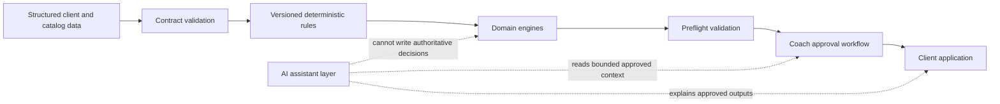
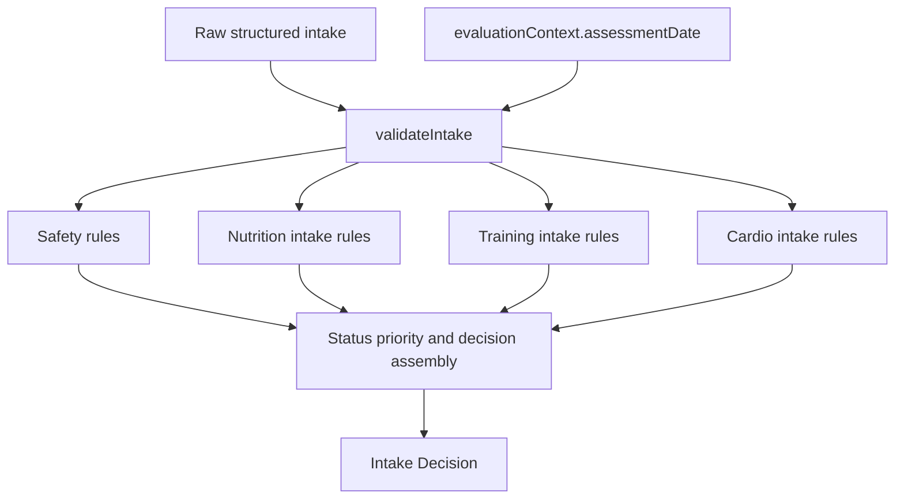
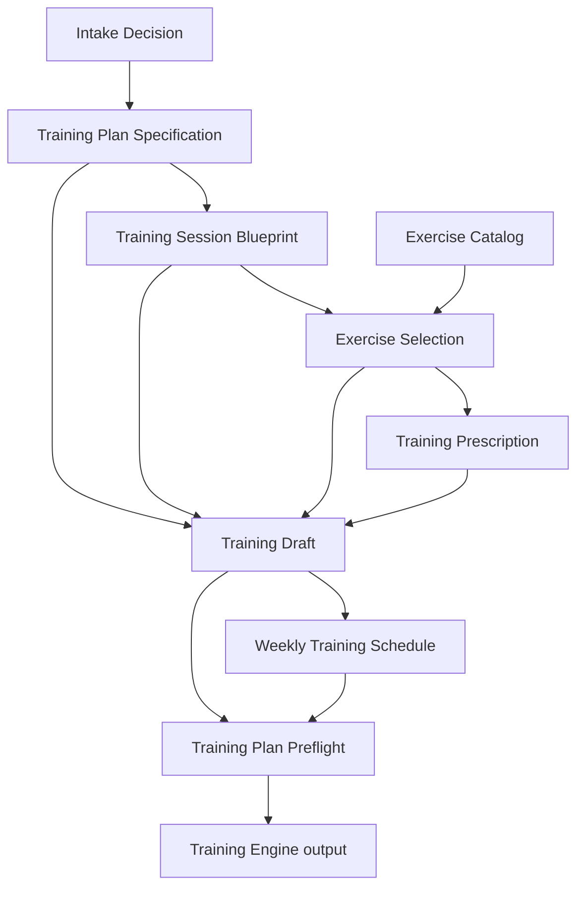
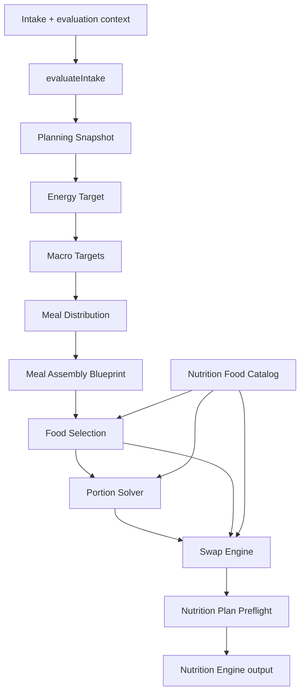
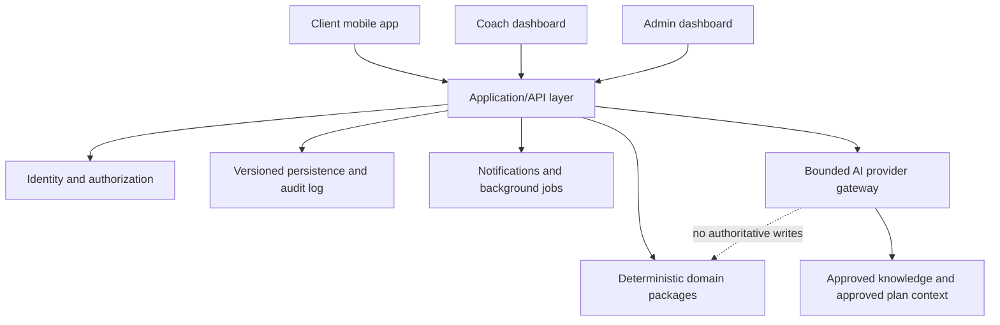

# Z Coaching Platform — System Architecture

## 1. Architectural style

The repository uses domain-first, deterministic modules with explicit
contracts, enums, policies, reason codes, constraints, issues, and tests.
Domain engines are pure JavaScript modules. They do not depend on a UI, API,
database, network service, or AI provider.

The intended system boundary is:



The dotted AI relationship is advisory, not executable authority. Domain
engines never call an LLM to determine a result.

## 2. Layer responsibilities

| Layer | Responsibility | Must not do |
|---|---|---|
| Contracts and validation | Define accepted data and reject invalid structures | Infer missing health meaning |
| Policies and rules | Apply versioned deterministic decisions | Depend on UI, persistence, or AI |
| Domain builders/engines | Compose valid upstream outputs through public APIs | Recompute another module’s owned decision |
| Preflight | Verify cross-stage consistency and review eligibility | Persist human approval |
| Application/API layer (future) | Orchestrate use cases, authorization, persistence | Contain coaching business rules |
| Coach approval (future) | Record accountable release decisions | Rewrite engine history |
| Client apps (future) | Capture inputs and deliver approved outputs | Generate authoritative plans |
| AI assistant (future) | Summarize, explain, search, draft communication | Override domain output or release a plan |

## 3. Current Intake Decision flow



Key invariants:

- `assessmentDate`, not the device clock, drives age.
- Safety status priority is deterministic.
- Higher-priority status retains useful lower-level flags and reasons.
- Free text is retained for review and never interpreted as a structured
  diagnosis or sport.

Safety is currently a rules layer inside Intake Decision Engine rather than a
separate public engine.

## 4. Current Training flow



The Training Engine facade consumes an existing Intake Decision. It does not
re-evaluate intake. Each stage owns one concern:

- Specification: days, split, ordered sessions.
- Blueprint: movement slots.
- Selection: eligible exercises.
- Prescription: sets, ranges/units, rest.
- Draft: composition.
- Schedule: weekly placement.
- Preflight: consistency and approval eligibility.
- Engine: public orchestration.

## 5. Current Nutrition flow



`buildNutritionEngine` runs all ten stages through their public APIs and retains
each complete stage output. It does not embed the food catalog in the result,
and its final status is mapped only from Nutrition Plan Preflight.

## 6. Pipeline Trace

Pipeline Trace Core accepts caller-supplied metadata:

```text
stage code + version + status + issue/reason codes + optional duration
  -> validation, ordering, deduplication, deep freeze
  -> metadata-only trace
```

It does not execute engines, infer status, time stages, or store full stage
outputs. It is intentionally not integrated into Training or Nutrition yet.

## 7. Status and approval boundary

The repository has several domain-specific status vocabularies. They are not
interchangeable:

- Intake: `READY_FOR_DRAFT`, `COACH_REVIEW_REQUIRED`,
  `MEDICAL_REVIEW_REQUIRED`, `BLOCKED`.
- Downstream plan stages: typically ready, provisional/review, or withheld.
- Preflight: passed/ready, review required, or withheld.

Training `can_approve` and nutrition `ready_for_coach_review` mean the artifact
is eligible to enter a human workflow. They do not prove that a coach approved
it. The future approval layer must record actor, decision, time, comments,
source versions, and immutable plan identity.

## 8. Future platform shape



Platform layers may orchestrate domain modules but must not duplicate their
rules. The API persists inputs and complete versioned outputs. Client delivery
must reference an approved immutable plan version.

## 9. Dependency rules

1. A downstream module may import only documented public APIs from an upstream
   module.
2. Upstream modules must not import downstream planning modules.
3. Domain code must not import application, persistence, UI, or AI code.
4. Catalogs are explicit inputs or versioned domain data, not hidden remote
   lookups.
5. A facade coordinates stages but does not copy their business rules.
6. Validation errors and `TypeError`s are not swallowed or converted into
   successful states.
7. Outputs that promise immutability must be independent and deeply frozen.

See [DEVELOPMENT_RULES.md](DEVELOPMENT_RULES.md) for implementation policy and
[AI_ARCHITECTURE.md](AI_ARCHITECTURE.md) for the assistant boundary.
